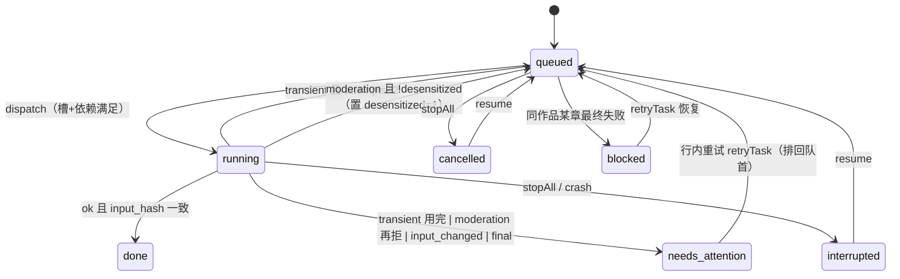
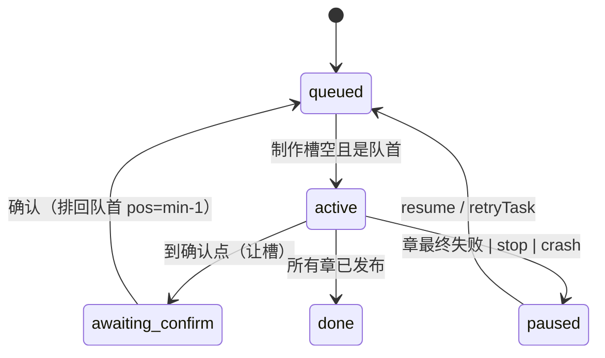
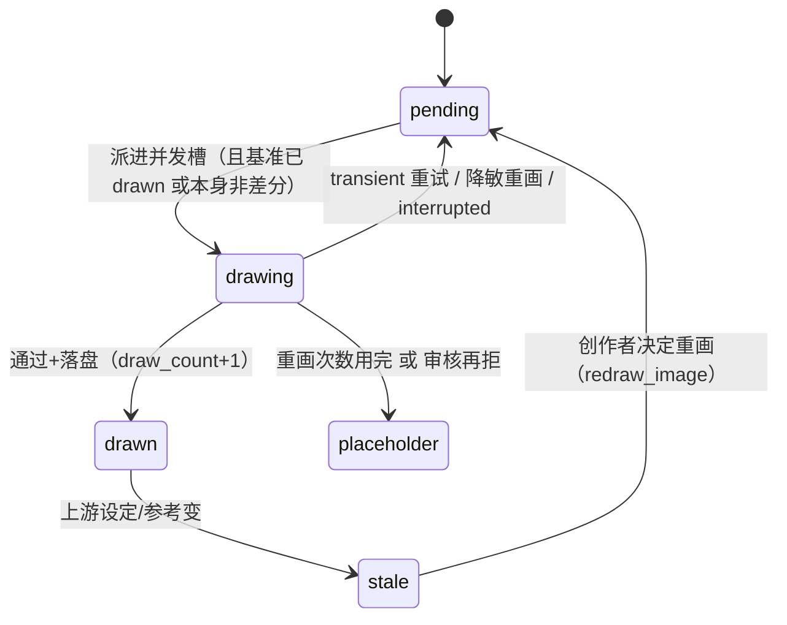

# R3 调度器：任务队列与出图队列的持久化与调度

实验代码在 `.workflow/evidence/spikes-r3/scheduler/`（`schema.sql` DDL、`scheduler.mjs` 调度核心、`sim.mjs` 确定性模拟器、`unit.mjs` 单元测试）。Node v24.18.0，`node:sqlite`。

## 1. 结论

1. **队列必须是独立表，不能和 `run`/`run_step` 混用**：`run`/`run_step` 是事实记录（`pi-scaffolding.md:92-93`），队列是意图。审计报告 A3（`ext-2026-11-r2-audit-agent.md:41`）建议新增 `task`/`job` 表，本实验确认推荐方案 (a)：新增 `work`/`task`/`task_dep`/`asset`/`chapter` 五张表承担队列，`run` 只做记录。混在一起会让“重跑”语义含糊——重跑是关旧 run 开新 run，不是改状态。
2. **出图队列的实体是 `asset` 不是 `task`**：同一张图只画一次、基准图先于差分、过期可重画——这三条用 task 表达都会撞车（一次画完的 task 死了，重画需要新 task，而“只画一次”又要去重）。把 asset 做成队列实体、task 只是当前一次尝试，部分唯一索引 `UNIQUE(work_id, ref_id) WHERE kind='image'` 一行终身，原地复活。这是 fuzz 逼出来的第二个设计改动。
3. **软/硬依赖必须区分**：优先章用预览摘要衔接的前提是“上一章的 task 没完成”，如果一律写成硬依赖，优先章会死锁；如果一律可豁免，`redo_chapter` 会在上一章还没写时抢先跑。fuzz 抓到 `redo-11` 在上一章 `queued` 时就 `running` 的违例，原因是豁免逻辑没看 `dep.soft`。修法：只有 `soft=1` 且章被用户设为优先时才豁免。
4. **`redo_chapter` 必须拒绝“原章还没做完”的情况**：对话面板 `propose_redo_chapter`（`novelive-agent.md:142`）确认后章进队列，但如果原章 task 还在 queued/running，redo 会永久等自己的 dep。规格要在提议时就拒绝，不是进队列再堵。
5. **章失败暂停的粒度被文档写反过一次**：`onFinalFailure` 初版把作品的 queued 章全标 `blocked`，但忘记正在 `running` 的章任务也会被 `stopAll`/`resume` 的时序复活——真正干净的做法是失败时只动 work 状态和 queued 任务，running 任务让它按自己的错误路径走完。
6. **已确认的冲突/缺口（写进 §3）**：章失败“整部作品暂停”只在 `decisions.md:582` 和 `handoff-defaults.md:40` 有，`creation-pipeline.md:69`/`ux.md:31` 写了但没有状态转移定义；`ux.md:25` 的章三态和 `creation-pipeline.md:57` 的四步流程对不上“排队中算等待还是制作中”；确认点让位后“排回队首”没有定义“如果此时别的作品在制作中，是插到最前还是等它失败/确认”（实测按 queue_pos-1 插到最前，可行）。
7. **fuzz 共跑约 5000 seed，最终版本无违例**；中途发现并修掉 4 个真 bug（见 §4、§6）。
8. **M1a 规格建议文本** 在 §6，可以直接抄。

## 2. 调度规则清单（从文档逐条抽出，编号 R1–R18）

| # | 规则 | 出处 |
| --- | --- | --- |
| R1 | 同一时间只制作一部作品，其余排队，创作者可调顺序 | `decisions.md:104-106`、`ux.md:27`、`creation-pipeline.md`（隐含） |
| R2 | 停在确认点的作品让出制作槽，后面的先做；确认后**排回队首** | `creation-pipeline.md:24`、`ux.md:27`、`decisions.md:509` |
| R3 | 第一章优先；作品内创作者可把指定章设为优先 | `creation-pipeline.md:56`、`ux.md:28` |
| R4 | 优先章的上一章还没写时，写手用上一章的**全书预览摘要**衔接；上一章写完后不回头改 | `creation-pipeline.md:56`、`decisions.md:434` |
| R5 | 制作按卷推进：第一卷综合完就开始制作，后续卷后台继续 | `creation-pipeline.md:13` |
| R6 | 每章流程固定四步：写 / 审稿 / 演出与图清单 / 出图，每步存盘，停后从没做完的步接着做 | `creation-pipeline.md:57` |
| R7 | 写手串行：写手一章接一章写，衔接用上一章剧本结尾 | `creation-pipeline.md:62`、`decisions.md:494` |
| R8 | 写和画重叠：写手写下一章时，上一章在出图 | `creation-pipeline.md:62`、`decisions.md:494` |
| R9 | 出图队列按素材排：**同一张图只画一次**；基准图画完它的差分才开始画 | `creation-pipeline.md:61`、`visuals.md:42`、`decisions.md:494` |
| R10 | 同时画的图 ≤「同时出图数」默认 8；每张图经技术检查+视觉审核，不通过换提示词重画，最多「生图失败重试次数」默认 3 次，用完用占位图标“需要处理” | `creation-pipeline.md:61`、`visuals.md:36,42`、`decisions.md:501` |
| R11 | 每张通过的图**立即保存**；停止后重跑跳过已有的图 | `creation-pipeline.md:61`、`decisions.md:448` |
| R12 | 一章的图都齐就**已发布**；最终失败的章用占位图也能玩（已发布+需要处理标记） | `creation-pipeline.md:63`、`ux.md:25` |
| R13 | 立即停止：取消排队任务并中断正在跑的请求；下次继续重跑被中断的任务 | `creation-pipeline.md:67`、`ux.md:29`、`decisions.md:155` |
| R14 | 临时错误两层重试；审核拒绝不算临时错误、不耗重试次数，先降敏改写一次，再拒→占位图+需要处理 | `creation-pipeline.md:68,70`、`decisions.md:634`、`pi-scaffolding.md:66,69`、`visuals.md:46` |
| R15 | 一章最终失败时**整部作品暂停**（写手串行依赖）；行内重试排回队首，成功后恢复 | `decisions.md:582`、`handoff-defaults.md:40`（docs 缺，见冲突） |
| R16 | 崩溃或异常退出后重开，制作保持停止，创作者确认后才继续 | `creation-pipeline.md:73`、`ux.md:90` |
| R17 | 任务开始时记下所用原文和设定哈希，落盘前重算；变了不写入，标“输入已改，需要重跑”（`needs_attention`+`error_type='input_changed'`） | `creation-pipeline.md:71`、`decisions.md:654`、`pi-scaffolding.md:92,96` |
| R18 | 上游设定或参考变化后，受影响图片标“过期”，由创作者决定重画或保留；重画上游提示连带 | `ux.md:32`、`visuals.md:111` |
| R19 | 作品设置随时可改，改动只影响**还没开始的任务** | `creation-pipeline.md:35,37` |
| R20 | `propose_redo_chapter`/`propose_resynthesize_volume`/`propose_redraw_image` 确认后进制作队列 | `creation-pipeline.md:98`、`ux.md:42`、`novelive-agent.md:142-145`、`pi-scaffolding.md:99` |

### 冲突与欠规格（规则间）

- **C1 章失败暂停的状态转移缺失**：R15 在 docs 只写“整部作品暂停、行内重试排回队首”，没有说①暂停时正在跑的图任务怎么办（本设计：让它们跑完，章暂停只停章管线）；②queued 章是标 `blocked` 还是留在 `queued`（本设计用 `blocked`，恢复时转回）；③“需要处理”的章是否阻塞后续章（按写手串行，是）。A10（`ext-2026-11-r2-audit-agent.md:48`）已指出 docs 缺这条。
- **C2 章“等待”vs“制作中”的边界**：`ux.md:25` 说等待=没开始，`creation-pipeline.md:57` 说出图阶段章仍“制作中”。排队中的章显然是“等待”，但“剧本已写完、在等出图”也是“制作中”——三态够，缺的是**排队中的优先级章是否显示为“等待”**（按文字算是）。本设计用 `chapter.user_state` 独立于 task 状态，`waiting` 覆盖所有未开始和排队中。
- **C3 “排回队首”的精确语义**：`ux.md:27`/`decisions.md:509` 说确认后排回队首，没定义当前有作品在制作时是否插队。本设计 `queue_pos = min(active)-1`，即插到最前（下一部作品开始前生效，不打断在跑的）。
- **C4 审核拒绝“重试这一次走新任务”**：`novelive-agent.md:109` 说降敏重画走新任务不沿用旧状态——本实现同一 task 行内 `desensitized` 标记复活（asset 唯一性要求），和“新任务”的字面冲突但语义一致：新 run、新 input_hash、新尝试计数。规格要写清是“新 run”不是“新 task 行”。
- **C5 文本调用“不限并发”vs“只制作一部作品”**：`creation-pipeline.md:108` 说文本调用不限并发、并发来自角色分工。写手串行已是分工约束，但**逐章预览可并行**（`creation-pipeline.md:11`）和“同一时间只制作一部作品”并存——预览/综合不算“制作槽”占用（`handoff-defaults.md:47` phase 枚举里 preview/producing 并列），所以单作品槽只管 `chapter`/`image` 类任务，`preview`/`synthesize` 不受槽限制。规格要写明。

## 3. 与现有文档/决策的冲突或缺口

| 位置 | 文档说 | 本实验观察/修法 | 建议措辞 |
| --- | --- | --- | --- |
| `creation-pipeline.md:69` | 章失败整部作品暂停，行内重试排回队首 | 缺状态转移：暂停时 running 图任务继续、queued 章标 `blocked`、章 `flagged=1` | §4.2 补一条：“章最终失败时：作品暂停（chapter 管线停，已派出的图任务跑完）；失败的章标‘需要处理’；未开始的章任务转 blocked；行内重试把该章任务重置为 queued 并排到章管线头部，成功后作品恢复 queued→active” |
| `ux.md:25` | 章三态：等待/制作中/已发布 | 排队中的章和“等出图”都算制作中的哪个没说清 | “等待”覆盖未开始和排队中；“制作中”覆盖写/审/演出/出图任一阶段进行中 |
| `pi-scaffolding.md:99` | M1a 规格补任务队列表 | 见 §5 DDL | 直接抄 §5 |
| `novelive-agent.md:109` | 降敏重画“走新任务，不沿用旧任务状态” | 实现成同一 task 行内 `desensitized` 复活（asset 唯一性） | 改为“走新 run，不沿用旧尝试的审核拒绝状态；task 行可复用，重画计数清零” |
| `handoff-defaults.md:31` | project.db 一次设计全量表 | 本实验给出 task/task_dep/asset/chapter/work 五表 | 把这五表并进 M1a 的 schema |
| `decisions.md:582` | 章失败暂停（依据 docs/creation-pipeline.md） | docs 本身没写状态转移 | 在 `creation-pipeline.md` §4.2 补上（见上） |

## 4. 需要所有者取舍的事

1. **`redo_chapter` 对未完成章的语义**：本实验拒绝（原章没做完提议就拒绝）。也可以做成“等价于优先该章”——把原章 task 提优先级。推荐拒绝：对话面板里 redo 一个还没做的章没有用户意义。
2. **章失败暂停时已派出图任务**：本实验让它们跑完（钱已花）。也可以一起停。推荐跑完——占位图逻辑本来就在。
3. **暂停作品的图队列**：章失败暂停后，该作品 asset 表里 pending 的图要不要继续画？本实验继续画（dispatchImages 不限定 work 必须 active，只排除 paused 里 chapter 类）。这里我倾向**继续画**：画好的图对恢复后的章直接可用，不浪费已花的钱。规格要写明。
4. **过期图的重画是否自动进队**：`visuals.md:111` 说“由创作者决定”。本实验 `editInput` 标 `stale` 后**不自动重画**，等创作者在编辑器点重画→`redraw_image` 工作流。符合文档。
5. **确认点 1 的候选图生成**：3 版设定图是同步生成还是进出图队列（`ext-2026-11-r2-audit-product.md:186` 已列为欠规格）？本实验未覆盖，M1b 定。

## 5. 表结构（DDL 全文在 `.workflow/evidence/spikes-r3/scheduler/schema.sql`，这里是要点）

```sql
-- 一部作品一行：queue_pos 全序、单 active 部分唯一索引保证单槽
CREATE TABLE work (
  work_id TEXT PRIMARY KEY,
  queue_pos INTEGER NOT NULL,
  status TEXT CHECK (status IN ('queued','active','awaiting_confirm','paused','done')),
  pause_reason TEXT,          -- 'chapter_failed'|'crash'|'stop'|'confirm1'|'confirm2'
  settings_rev INTEGER DEFAULT 0
);
CREATE UNIQUE INDEX work_one_active ON work(status) WHERE status='active';

-- 意图行：每个待做事一条；kind 区分章/图/预览/综合/redo
CREATE TABLE task (
  task_id TEXT PRIMARY KEY,
  work_id TEXT NOT NULL REFERENCES work(work_id),
  kind TEXT CHECK (kind IN ('preview','synthesize','chapter','image','redo_chapter','resynthesize')),
  ref_id TEXT NOT NULL,                 -- chapter_id / asset_key / volume_id
  phase TEXT DEFAULT 'queued',          -- 章专用: queued|write|review|stage|await_draw|done
  status TEXT DEFAULT 'queued' CHECK (status IN
    ('queued','running','done','needs_attention','cancelled','interrupted','blocked')),
  priority INTEGER DEFAULT 0,           -- redo=2, 用户优先章=1


  seq INTEGER,                          -- 插入序，tiebreak
  attempts INTEGER DEFAULT 0,           -- 临时错误重试已用次数
  desensitized INTEGER DEFAULT 0,       -- 审核拒绝降敏已用次数
  error_type TEXT,                      -- transient|moderation|input_changed|final
  input_hash TEXT,                      -- 开工时快照的原文+设定哈希
  settings_rev INTEGER,                 -- 开工时快照（新设置只影响未开始任务）
  run_id TEXT                           -- 当前/最近一次 run 记录
);
-- 图任务一行终身（asset 是队列实体，task 是一次尝试）
CREATE UNIQUE INDEX task_image_once ON task(work_id, ref_id) WHERE kind='image';

CREATE TABLE task_dep (
  task_id TEXT REFERENCES task(task_id),
  depends_on TEXT REFERENCES task(task_id),
  soft INTEGER DEFAULT 0,               -- 1=优先章可用预览摘要豁免
  PRIMARY KEY (task_id, depends_on)
);

CREATE TABLE asset (
  asset_key TEXT, work_id TEXT,
  kind TEXT CHECK (kind IN ('base','variant','cg')),
  base_key TEXT,                        -- 差分->基准
  status TEXT CHECK (status IN ('pending','drawing','drawn','stale','placeholder','failed')),
  draw_count INTEGER DEFAULT 0,         -- 每次 version 内成功落盘数，>1 = 画了两次
  version INTEGER DEFAULT 0,
  chapter_id TEXT,
  PRIMARY KEY (work_id, asset_key)
);

CREATE TABLE chapter (
  chapter_id TEXT, work_id TEXT, ord INTEGER,
  user_state TEXT CHECK (user_state IN ('waiting','producing','published')),
  flagged INTEGER DEFAULT 0,            -- 需要处理
  prioritized INTEGER DEFAULT 0,
  PRIMARY KEY (work_id, chapter_id)
);
```

### 三种候选形状对比

| 方案 | 优点 | 缺点 | 结论 |
| --- | --- | --- | --- |
| A. 通用 DAG 表：一张 `task` + `task_dep` 边表表达所有依赖 | 统一、任意工作流都能表达 | 出图去重、章串行、作品单槽都要靠代码拼，规则没有数据库层保证 | 不取（规则太散） |
| B. 分类表：`work`/`chapter`/`asset`/`task`/`task_dep` | 每类实体的队列语义各自落在自然表上：asset=图队列、work=制作槽、task=执行意图 | 表多一点 | **取**——本实现 |
| C. 事件溯源：所有状态由 event 表重放 | 崩溃恢复天然、可审计 | 重放慢、查询麻烦、对 M1a 过度 | 不取 |

B 的关键是**分层的实体各管各的不变量**：`work` 表管单槽和让位；`task`+`task_dep` 管串行和依赖；`asset` 管“每张图只画一次”和基准→差分；`chapter` 管用户看到的 等待/制作中/已发布 + 需要处理 标记。run/run_step 只记事实。

### 状态机







## 6. 实测

### 方法

`scheduler.mjs` 是调度核心，`sim.mjs` 是确定性模拟器（mulberry32 PRNG，假 worker 随机时长/临时失败/审核拒绝/最终失败；用户动作随机：stop/resume/confirm/moveWork/prioritize/editInput/changeSettings/crash/retryFailed/redoChapter；crash 随机点 kill 后 reopen 同一 DB 文件）。每步之后 `checkInvariants()` 全表断言。

### 检查的不变量（每步都查）

- 至多一个 `work.status='active'`（单制作槽）
- 每个 work 至多一个 `kind IN (chapter,redo_chapter)` 且 `status='running'`（写手串行）
- `asset.status='drawing'` 数量 ≤ `imageConcurrency`（8）
- 差分 asset 为 `drawing|drawn` 时其基准必须 `drawn`（基准先于差分）
- `asset.draw_count > 1` 且非 `stale` 的不存在（每张图只画一次）
- `work.status='paused'` 时没有 `chapter` 类 `running` 任务（章失败暂停）
- task 无 NULL 状态（无任务丢失）

### 命令

```bash
cd .workflow/evidence/spikes-r3/scheduler/
node unit.mjs          # 15 条规则单元测试，全过
node sim.mjs 4000 400  # 4000 seed × 400 步 fuzz
node sim.mjs 300 400   # 小批量
```

### 结果

- **unit.mjs**：15/15 PASS
- **sim.mjs**：多轮共约 5000 seed；4 个 bug 全修后，末轮 4000 seed × 400 步 0 违例（`fuzz4000.log`）
- 中途发现并修复的真 bug（设计演化，见 §4）：
  1. `stopAll` 不中断 running chapter 任务（inflight 未注册 chapter）→ 补 `_registerInflight`
  2. 出图 task 重建时撞 `UNIQUE(work_id,ref_id)`（resume 复活旧 cancelled 行 + dispatch 又插新行）→ 改为 asset 一行终身原地复活
  3. `redo_chapter` 在上一章未做时硬等 dep 死锁 / 软 dep 被优先章无差别豁免 → 区分 soft/hard dep 且 redo 只在原章 done 后允许
  4. `finish('ok')` 对 `redo_chapter` 不匹配 `kind==='chapter'` 分支 → inflight 已删但 task 卡 `running`（`redo-38` 案例）→ `redo_chapter` 并入章管线分支

## 7. M1a 规格建议文本（可直接抄）

> **任务队列（`project.db`）**：`run`/`run_step` 记事实，队列是意图，用 `work`/`task`/`task_dep`/`asset`/`chapter` 五表。`work` 一行一部作品，`queue_pos` 全序、部分唯一索引保证至多一个 `status='active'`；确认点让位=`awaiting_confirm`，确认后 `queue_pos=min(queued)-1` 排回队首。`task` 记每个待做事，`kind` 区分 `preview|synthesize|chapter|image|redo_chapter|resynthesize`；章管线每作品同时至多一个 `chapter` 类 `running`。`task_dep` 记依赖，`soft=1` 的边可被用户优先章豁免（写手拿预览摘要衔接）。`asset` 是出图队列实体：每资产一行终身（`UNIQUE(work_id,asset_key)`），`status` 走 `pending→drawing→drawn|placeholder`，差分行带 `base_key`、基准 `drawn` 才可派；同一 work_id+asset_key 的 image task 唯一（`UNIQUE(work_id,ref_id) WHERE kind='image'`），原地复活记 `attempts`/`desensitized`。`chapter` 记用户态 `waiting|producing|published` + `flagged`（需要处理）。开工时 task 快照 `input_hash`（原文+设定哈希）和 `settings_rev`，落盘前重算哈希、不一致标 `needs_attention`+`error_type='input_changed'`；设置改动只增 `work.settings_rev`，已开始任务沿用旧值。章最终失败 → 该章 `flagged=1`、作品 `paused`、queued 章转 `blocked`；行内重试把该章 task 重置为 `queued`（排前）、blocked 转回 queued、作品转 `queued`。立即停止：queued→`cancelled`、running→`interrupted`、作品→`paused`；resume 把 `cancelled|interrupted` 复活为 `queued`、作品转 `queued`。崩溃恢复：启动时 `running`→`interrupted`、`active`→`paused`（`pause_reason='crash'`），创作者确认后 resume。审核拒绝不耗 `attempts`：置 `desensitized=1` 降敏重画一次，再拒→`placeholder`+`flagged`。文本类调用（preview/synthesize/review）不占制作槽，可并行。

## 8. 可直接拿去用的产物

- `.workflow/evidence/spikes-r3/scheduler/schema.sql` — DDL，可直接并进 M1a 的 project.db schema
- `.workflow/evidence/spikes-r3/scheduler/scheduler.mjs` — 调度核心（约 400 行 JS，`node:sqlite`），可移植进 `packages/creator`
- `.workflow/evidence/spikes-r3/scheduler/sim.mjs` — 确定性 fuzz 模拟器，改 worker 真实实现后可当回归测试
- `.workflow/evidence/spikes-r3/scheduler/unit.mjs` — 15 条调度规则的单元测试

## 追加：活性检查

在第一轮只查安全性不变量后，补了活性检查（`.workflow/evidence/spikes-r3/scheduler/live.mjs`）和双重执行检测（task 表加 `starts`/`done_once` 列）。这轮查出 **5 个新的真 bug**，全部是“安全不变量全过但系统不前进”的死锁类。

### 活性检查项

1. **无故障运行**：只注入 stop/resume/confirm/moveWork/prioritize（不注入模型失败），每部作品必须在有限步内 `done`。
2. **有故障运行**：跑到静默态（无 running、无待处理用户动作、能 resume/confirm 的都做了）时，每个 task 必须是 `done`/`needs_attention`（带 `error_type`）/`blocked`/`cancelled`；`queued`/`interrupted` 只允许出现在 `paused` 的作品上（等用户行内重试）；任何 work `active` 或槽空时 `queued` 的任务依赖必须没全满足才算合理等待。
3. **不重复执行**：task 到过一次 `done`（`done_once=1`）后永远不能再 `running`（redo/重画开新 task 行或原地复活仅在非 done 状态）。

### 这轮发现并修复的 bug（活性类，全部进最终版）

5. **作品永远到不了 `done`**：`dispatch` 的完成判定 `undrawn` 数 `phase='await_draw'` 但没排 `status='done'`，章 task 全部 done 后仍被算成“没画完”，作品卡 `active` 占槽，后面作品饿死 → `AND status!='done'`。
6. **`interrupted` 任务永久丢失**：`resume` 只在作品 paused 时被调，若作品经 `retryTask`/`reopen`+activate 等别的路径回到队列，它的 `interrupted`/`cancelled` 任务没人复活 → `step()` 在激活作品时一并复活该作的 `interrupted|cancelled` 任务（不依赖 resume 被恰好调用）。
7. **`resume` 作用域错**：原版全局 `UPDATE task ... WHERE status IN ('interrupted','cancelled')` 会把别的还 paused 作品的任务也复活 → 按 `work_id` 限定；同时补“asset 卡 `drawing` 但 task 已不在 running”的 reconcile（孤儿 drawing 回到 pending）。
8. **`stopAll`/`reopen` 覆盖 `pause_reason='chapter_failed'`**：stop/crash 把因章失败暂停的作品也标成 stop/crash，之后 `resume` 把它直接拉起——作品变成 `active` 但那章仍 `needs_attention`，其余章 `blocked`，形成**死槽**（active 不动，后面作品全饿死）。修法：stop/crash 只在作品原非 chapter_failed 时改写 reason；`confirm` 只接 `awaiting_confirm` 的作品，不再无差别拉起。
9. **图片最终失败不该暂停作品**：`finish('final'|'transient' 耗尽)` 对 `kind='image'` 原来走 `onFinalFailure`（暂停整部作品）。按文档图片最终失败=占位图+需要处理、作品继续 → image 分支单独置 `placeholder`+`maybePublish`，不进 `onFinalFailure`。
10. **`retryTask` 对任何 task 都解除 chapter_failed 暂停**：重试一张图也会把因章失败暂停的作品拉回 active（死槽变体）→ 只有重试 `chapter`/`redo_chapter` 类任务才清 `chapter_failed` 暂停；同时 image 重试时 asset 复位 `pending`（原版 placeholder 卡死不再派）。

### 结果（最终代码，`scheduler.mjs` ~430 行）

| 检查 | 规模 | 结果 |
| --- | --- | --- |
| `unit.mjs` 15 条规则 | — | 15/15 PASS |
| `live.mjs free`（无故障，只注入用户动作） | 2000 seeds | 0 违例；**上界 maxSteps=40**（2 作品 4+3 章、每章 1 基准+1 CG，所有任务一次成功） |
| `live.mjs faulty`（随机失败+崩溃+用户动作，静默态断言） | 2000 seeds | **0 违例** |
| `sim.mjs` 安全不变量 fuzz（最终代码重跑） | 2000 seeds × 400 步 | **0 违例**（`fuzz_final.log`） |

步数上界 40 = 7 个章任务 × ~4 步 + 图任务穿插，说明无故障时调度没有空转。

### 规格补充（并进 §7 M1a 文本）

- 图片任务最终失败（重试/降敏/占位判定后仍不成）→ `asset.status='placeholder'` + 章 `flagged=1`，**作品不暂停**；只有 `chapter`/`redo_chapter` 类任务最终失败才 `work.status='paused'`。
- `chapter_failed` 的 `pause_reason` 不被后来的 stop/crash/confirm 覆盖；只有对失败章本身的 `retryTask` 能解除它。
- `resume` 按 work_id 限定复活范围；作品每次拿到制作槽（`queued→active`）时都顺带复活自己 `interrupted|cancelled` 的任务，不依赖 resume 是否被调到。
- `asset`  reconcile：卡 `drawing` 但无 running task → `pending`；`stale|placeholder|failed` 且有 queued task → `pending`。
